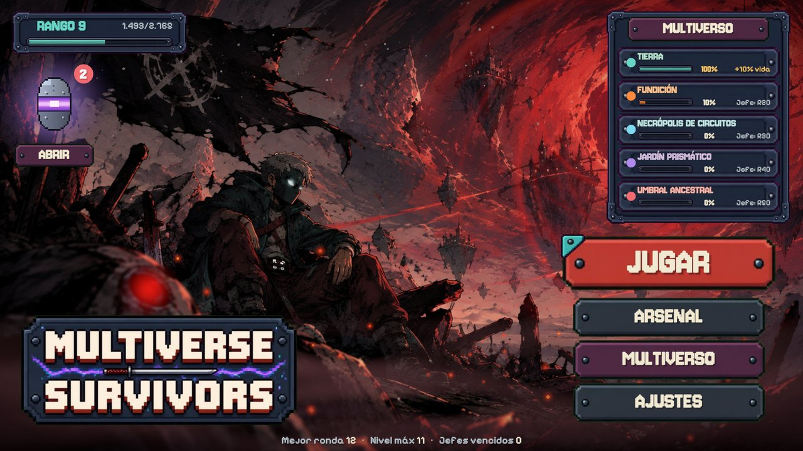
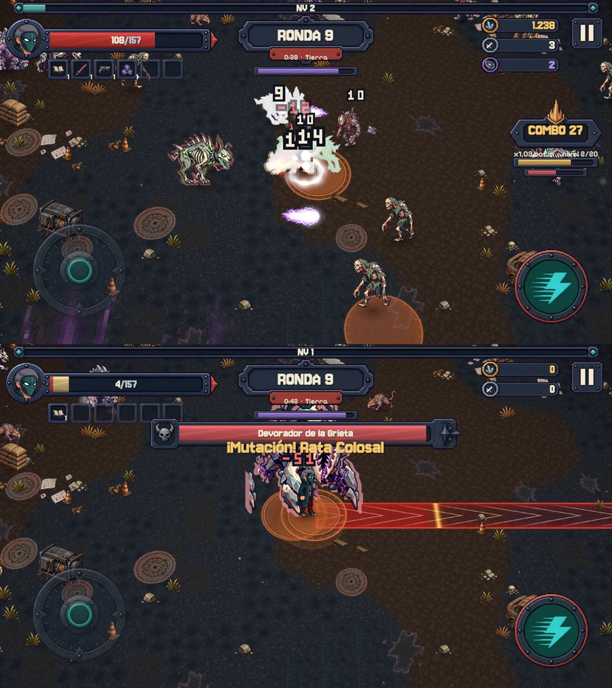
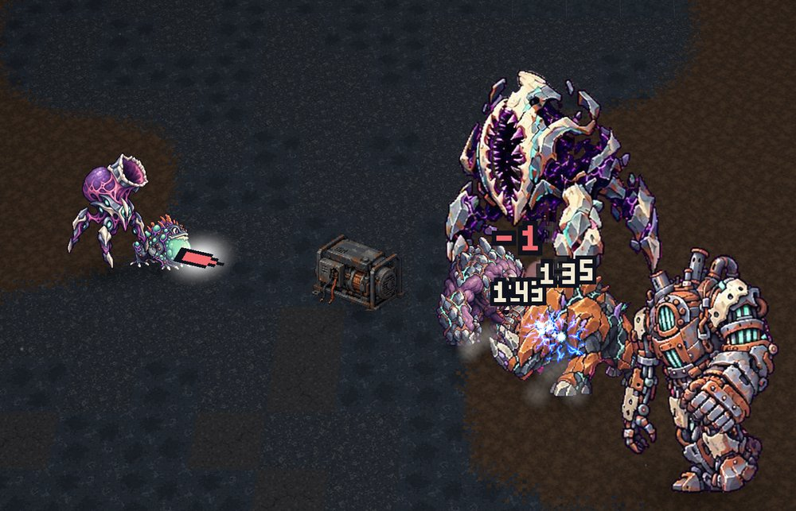
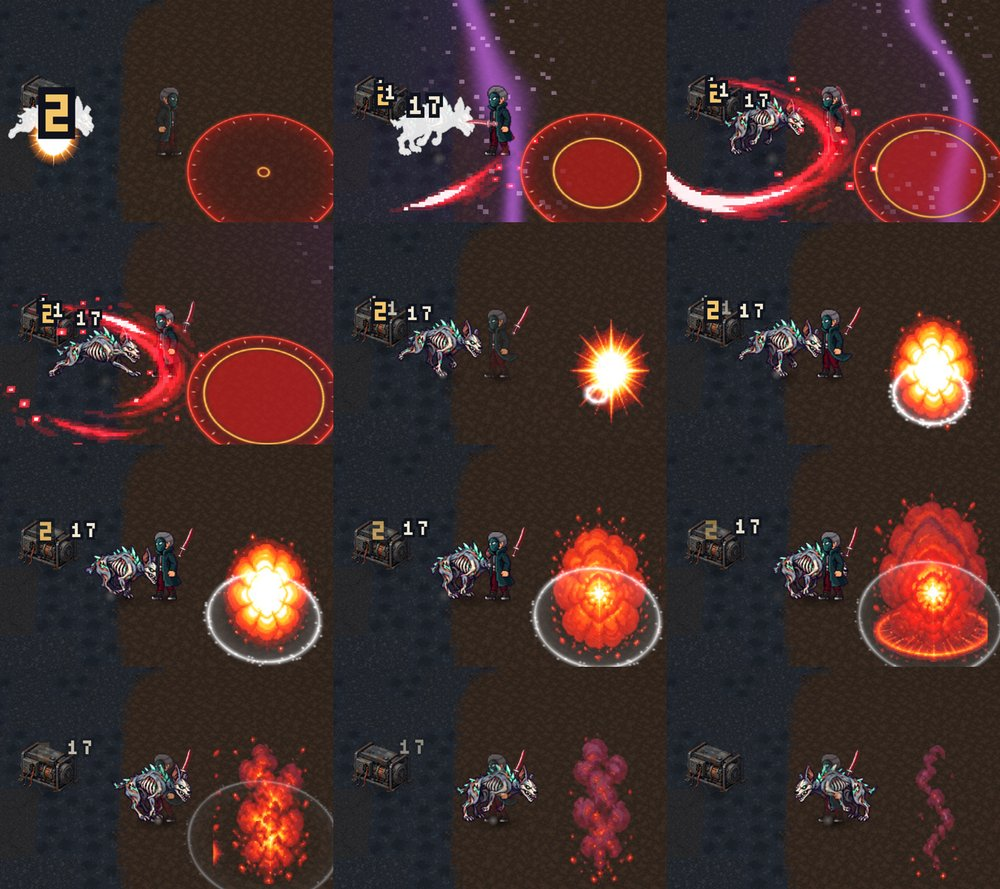
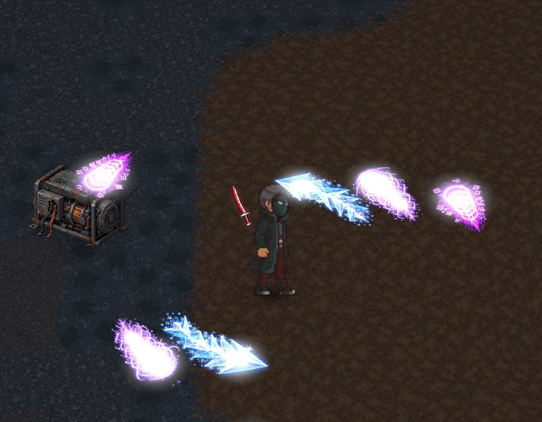

  
  
  
  
  

Survivor de acción en 2.5D para Android. Sobrevivís a hordas por rondas, juntás chatarra, mejorás tu arsenal y purificás realidades corrompidas venciendo a sus jefes.

> 🔒 **Repositorio vitrina.** El código fuente es privado; acá solo se muestra el proyecto.

## 🎮 Mecánicas

- **Rondas** de 45 s con respiro entre cada una y jefes cada 10 rondas. En la ronda 50, el Corazón de la Corrupción (2 fases), y después modo infinito.
- **Mapa multiverso**: Tierra en el centro, rodeada por la Fundición, la Necrópolis de Circuitos, el Jardín Prismático y el Umbral Ancestral.
- **Corrupción viva** que avanza cada ronda: en zona corrupta los enemigos son más fuertes pero sueltan el doble de botín.
- **Forja de grieta**: cada 3 rondas aparece una ruleta de mejoras.
- Armas, orbitales, proyectiles, combos y evoluciones.

## 📸 Capturas

  
  

---

© 2026 Tomás Vilche · Todos los derechos reservados

